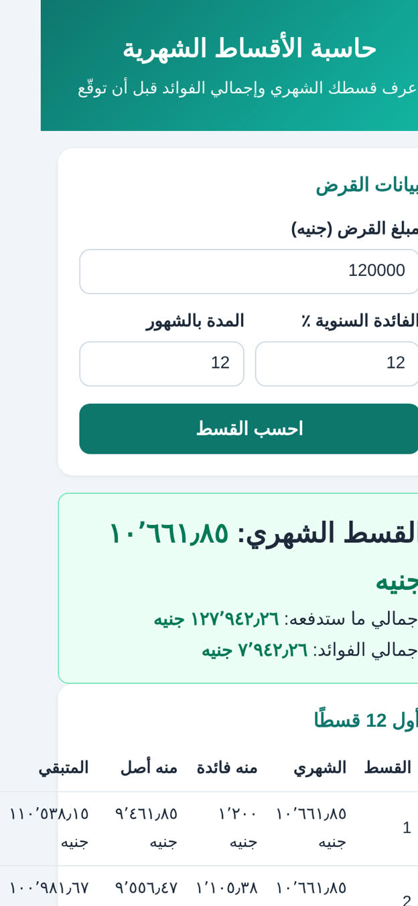

# Loan Installment Calculator | حاسبة الأقساط الشهرية

Calculate the fixed monthly payment for any loan from amount, annual interest and term, with total cost. Arabic interface.

**Live app:** https://abood-ayman.github.io/loan-installments-ar/

**LinkedIn:** [Project entry](https://www.linkedin.com/in/abdullah-ayman-1678b737b/details/projects/)

This is a personal project, built with AI tools.

## Features
- Fixed monthly payment (annuity method)
- Total payments and total interest over the full term
- Works with 0% interest (interest-free installments)
- Short schedule of the first 12 payments: interest vs principal

## Note
Guidance only: your bank's exact terms may differ.

## Privacy
Everything runs in your browser. No data is stored or sent anywhere.

## Run locally
Open `index.html` in any browser. It is a single static page with no dependencies.

## Status
Stable.

## Copyright
MIT License - Copyright (c) 2026 Abdullah Ayman.
